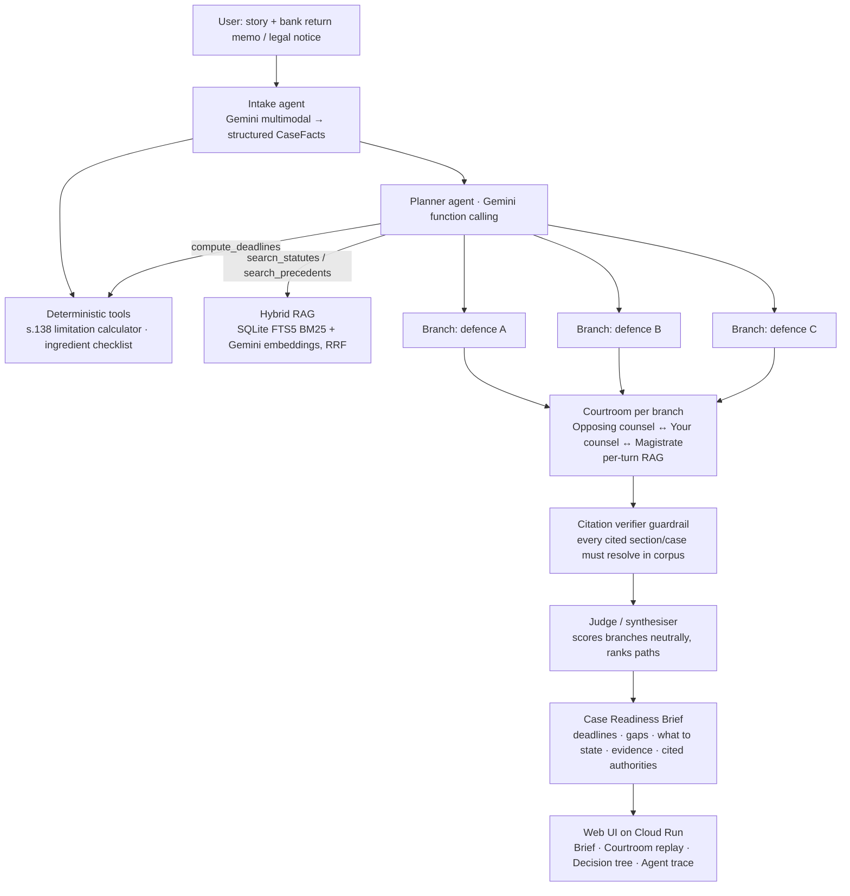

# LegisiMate → Google Cloud AI Builder Cup 2026 Submission Plan

Date: 2026-10-16. Status: proposed, awaiting the decisions in section 9.
Update 2026-10-17: team registration and Sustainability & Social Impact are confirmed. Build locally first with the supplied provider; deployment is deferred. The new workbench has no jury. The user subsequently authorized committing and pushing the local workbench and chat-export cleanup; preserve Git history without rewriting or force-pushing. Gemini and Google Cloud remain submission gates, not completed work.
Hard deadline: **prototype submission 18 Oct 2026** (confirm the cut-off time and time zone on the Hack2skill dashboard today).

## 1. What The AI Builder Cup Is (Researched)

| Item | Fact | Source |
| --- | --- | --- |
| Organiser | Hack2skill, sponsored by Google Cloud; "independently operated by Hack2skill, not directly administered by Google Cloud". | [aibuildercup.com](https://aibuildercup.com/) |
| Motive | "Start with a problem you understand, build a solution on Google Cloud, and show that something built for a local need can scale to a global one." Aimed at JAPAC's 15M+ developers. | [aibuildercup.com](https://aibuildercup.com/) |
| Who | Working professionals, entrepreneurs and startups only (no students), 21+, based in JAPAC, teams of 2–4. | [aibuildercup.com](https://aibuildercup.com/) |
| Timeline | Registration 1 Sep–11 Oct; team formation until 14 Oct; build 7 Sep–18 Oct; **submission 18 Oct**; evaluation 19 Oct–6 Nov; finalists 7 Nov; Demo Day in Singapore 4 Dec (2 members travel, sponsored). | [aibuildercup.com](https://aibuildercup.com/) |
| Themes (pick one) | BFSI; Retail & Commerce; Manufacturing; Media, Content & Digital Experiences; Future of Work & Enterprise Productivity; **Sustainability & Social Impact**. | [themes](https://aibuildercup.com/themes.html) |
| Mandatory tech | Gemini or Gemma models, or agentic platforms (Agent Platform, Antigravity, AI Studio); **deployed on Google Cloud via Cloud Run or Firebase**. Solutions "built primarily on other cloud platforms will not be eligible". | [themes](https://aibuildercup.com/themes.html), [FAQs](https://aibuildercup.com/Faqs.html) |
| Freshness rule | "Only fresh projects built during the hackathon timeline are eligible." | [FAQs](https://aibuildercup.com/Faqs.html) |
| Deliverables | Working deployed link; demo video under 3 min (public YouTube/Vimeo/Drive); public GitHub repo; deck converted to PDF. All in English. | [FAQs](https://aibuildercup.com/Faqs.html), [themes](https://aibuildercup.com/themes.html) |
| Prizes | USD 30k pool: 10k / 7k / 5k; USD 2k each for Best use of Google Cloud AI tools, Most Impactful Solution, Social Choice, Best UI/UX. | [rewards](https://aibuildercup.com/rewards.html) |

### Judging criteria (weights are official)

| Criterion | Weight | What judges look for |
| --- | ---: | --- |
| Technical Merit & Gen AI Implementation | **40%** | Gen AI contributes directly to solving the problem; functional and technically sound; scalable beyond the prototype. |
| Problem Alignment & Impact | 25% | Fits the chosen theme; clear value for intended users. |
| Innovation & Creativity | 25% | Fresh approach; Gen AI used beyond a basic or superficial implementation. |
| User Experience & Solution Design | 10% | Intuitive, accessible; components work together smoothly. |

### Previous editions

No earlier "AI Builder Cup" edition was found; 2026 appears to be the first under this name. Predecessors run by the same organiser and sponsor:
- **Google Cloud GenAI Hackathon APAC Edition (2024):** 38,000+ developers from 18+ APAC countries, 2,400+ ideas, 10 finalists pitching to a Google Cloud jury. Showcased themes included precision oncology, CT-scan analysis and a multimodal LLM agent platform for learning content ([recap](https://blog.hack2skill.com/a-recap-of-the-genai-apac-hackathon-by-hack2skill)).
- **Agentic AI Day 2025** (Gemini, Vertex AI, AI Studio, Firebase) and the **Gen AI Exchange Hackathon 2025** (India; top 100 teams before 30 industry jurors on 29 Nov 2025).
- **Gen AI Academy APAC Edition 2026:** cohorts plus quarterly hackathons; the AI Builder Cup site footer carries this brand.

Pages describing individual winning projects returned 403 errors, so no claim is made here about what specifically won. Pattern across these events: a working demo on the Google stack, presented live, matters more than a pitch.

## 2. Eligibility Check Against This Repository

| Rule | Status | Evidence / action |
| --- | --- | --- |
| Fresh project | **Pass** | First commit `05b5e1a` on 2026-10-15 23:41 IST; all work falls inside 7 Sep–18 Oct. Keep the commit history: it is the evidence. |
| Registered team of 2–4 | **Unknown, blocking** | Registration closed 11 Oct; teams locked 14 Oct. Confirm on the dashboard before investing further. |
| Gemini/Gemma or Google agent platform | **Fail today** | All model calls go through OpenAI's Responses API ([misofish/core.py](../../../misofish/core.py#L237)). |
| Deployed on Cloud Run/Firebase | **Fail today** | Loopback-only server ([misofish/server.py](../../../misofish/server.py#L534)); no Dockerfile, no GCP project; `gcloud` not installed locally. |
| Public GitHub repo | Pass, needs hygiene | Repo is public (HTTP 200). Section 6 lists exposure to remove. |
| Employer obligations | **Must confirm** | Built on an LSEG laptop with LSEG tooling. The original chat set up a model endpoint taken from an internal LSEG project. Confirm outside-activity and IP rules with your manager. Use a **personal** GCP project and Gemini quota; no LSEG credentials, endpoints or registries in the submission. |

## 3. Questioning Our Own Judgement

| Assumption we were making | Challenge | Decision |
| --- | --- | --- |
| "Show the courtroom; it is the wow factor." | Judges give 40% to *meaningful* Gen AI and 25% to impact. A theatrical simulation that produces uncalibrated percentages scores well on novelty but poorly on usefulness. | Lead with a **useful outcome**: a cited Case Readiness Brief. Keep the courtroom as the explainer ("see it argued"). |
| "Futures are explored." | Today five futures are preset in [misofish/court.py](../../../misofish/court.py#L33). Future #3 is literally titled "The Winning Playbook", and memory carries across branches ([L306](../../../misofish/court.py#L306)). Calling this agentic would not survive a technical judge. | A **planner agent derives the branches from this case's facts**. Each branch runs independently, a neutral judge scores it, and the best path is *found*, not scripted. |
| "Win probability 0–100." | It is a number the model writes ([L89](../../../misofish/court.py#L89)); the corpus cannot calibrate it. Only 2 cases have both a facts section and a conclusion section, and labels like ALLOWED/DISMISSED do not say which party won. | Headline metric = deterministic **statutory-ingredient and limitation check** (explainable, testable). Label any model estimate "simulated strength, not a prediction". |
| "Cover all Indian law." | The corpus is a deliberate NI Act / contract slice; constitutional retrieval returns commercial cases. | **Scope the demo to Section 138 cheque dishonour only.** Hide constitution/contract domains and the town/Twitter/Reddit modes in the submission UI. |
| "Jury in the courtroom." | Indian courts do not use juries; s.138 trials run before a Magistrate. Indian-law reviewers will notice. | Rename the jury to **"Law-student review panel"** (educational mode), or drop it (decision D3). |
| "Swap the base URL to Gemini's OpenAI-compatible endpoint." | The compatibility layer is beta and offers Chat Completions, not the Responses API we use. It also signals minimal Google integration for the "Best use of Google Cloud AI tools" award. | Use the native **`google-genai` SDK**. On Cloud Run, use Vertex AI mode with the service account: no API key in the container. |
| "One active simulation is fine." | [misofish/server.py](../../../misofish/server.py#L149) allows one run globally; concurrent judges would get HTTP 409. Cloud Run disk is ephemeral. | Allow concurrent runs with per-IP and daily call caps. Bake 2–3 **showcase runs** into the image so judges always see a complete result. |

## 4. Positioning

- **Theme (recommended): Sustainability & Social Impact.** Frame it as access to justice: "increasing accessibility, supporting communities, enabling more informed decision-making" (theme text). Alternative: *Future of Work & Enterprise Productivity* (lawyer case-preparation productivity). Decision D2.
- **Problem:** Cheque-dishonour cases under s.138 NI Act were reported at 35.16 lakh pending as of 31 Dec 2019, about 15% of pending criminal cases (Supreme Court suo motu *In Re Expeditious Trial of Cases under Section 138*, 2022). Secondary sources report 43 lakh+ by Dec 2024. **Verify both against the primary judgment before putting them on a slide.** Many complainants are MSMEs and individuals who miss strict statutory deadlines or underestimate standard defences.
- **Users:** (1) a small-business owner whose cheque bounced; (2) a junior lawyer preparing the case; (3) a law student practising argument.
- **One-line pitch:** "LegisiMate is an AI case strategist for India's cheque-bounce backlog. It checks your deadlines, predicts the defences the other side will raise, argues each one out in a simulated courtroom grounded in real statutes and judgments, and tells you what to say and what to prove."

## 5. Target Architecture (Gen AI + Agentic + RAG)

| Concept judges will look for | Where it lives |
| --- | --- |
| Generative AI | Turn generation, brief synthesis, multimodal document extraction (Gemini). |
| Agentic AI | Planner runs a bounded tool-calling loop and chooses branches from tool results. Multiple role agents argue each branch. Verifier and judge agents act as checks. The **agent trace panel** shows every tool call. |
| RAG | Hybrid retrieval (existing BM25 plus new Gemini embeddings) over 7,143 provisions and 10,139 judgment chunks, hierarchy-weighted, with the citation graph. |
| Guardrails / responsible AI | Citation verification, deterministic deadline maths, quote-validated evidence graph (exists), "not legal advice" banner, no stored user documents. |
| Google stack | Gemini via Vertex AI (`google-genai`), `gemini-embedding-001`, Cloud Run, Cloud Build, Secret Manager only if an API key is used locally. |

Model IDs must stay configurable via environment variables. Current docs list `gemini-3.8-flash` (fast turns) and `gemini-4-argon` (planner/judge). **Verify availability and quota in the chosen Vertex region on day 1.**

## 6. Work Plan (Ordered, With Cut Lines)

Principle: something deployed and submittable exists at every checkpoint. Freeze code by **18 Oct midday**; the rest of that day is reserved for the video, deck and submission.

### P0: Eligibility and deploy skeleton (must finish first)
1. Confirm registration/team (D1) and employer clearance. Create a personal GCP project with billing, a budget alert, and the Vertex AI and Cloud Run APIs enabled. Use **Cloud Shell** for `gcloud` (avoids local Zscaler/tooling issues).
2. **Gemini adapter:** reimplement `Model.generate` in [misofish/core.py](../../../misofish/core.py#L215) on `google-genai`, with Pydantic JSON schema, streaming partial JSON and usage accounting. Keep the method signature so the fake-model test suite stays valid.
3. **Schema size:** graph extraction passes up to 120 quotes as a `Literal` enum ([misofish/graph.py](../../../misofish/graph.py#L138)), which Gemini may reject. Switch to `str`; `_spans()` already validates quotes locally.
4. **Cloud-ready server:** bind `0.0.0.0:$PORT`; replace the localhost-only Host check with an `ALLOWED_HOSTS` env var. Fix the Origin check, which assumes `http://` ([misofish/server.py](../../../misofish/server.py#L398)) and would block every HTTPS POST. Allow concurrent runs with per-IP plus daily model-call caps.
5. **Dockerfile:** build `legal_poc.db` at image build time and include the showcase runs. Deploy with Cloud Run `--timeout=3600` (SSE), `--min-instances=1`, `--max-instances=1`, and a service account holding `roles/aiplatform.user`. **Checkpoint: public URL works end to end with Gemini.**
6. **Repo hygiene:** remove `docs/chat-export-vscode.json` and `docs/CHAT-TRANSCRIPT.md` (internal LSEG hostnames and project references; no live secrets found). Move the MiroFish and REA documents out of the submission. Rewriting history needs approval (D4).

### P1: Make it useful and genuinely agentic
7. **Intake agent:** narrative plus optional image/PDF of the return memo or notice → `CaseFacts` (cheque date, presentation date, return-memo receipt date, notice date, reason for dishonour, amount, parties). The user confirms or edits the extracted dates.
8. **Deadline and ingredient tool (deterministic):** encode s.138 provisos (a)–(c) and s.142(1)(b), each rule linked to its corpus chunk ID. Verify every rule against the retrieved statute and RBI cheque-validity text before encoding. Unit-test the edge cases.
9. **Planner agent with function calling:** tools `search_statutes`, `search_precedents`, `compute_deadlines`, `get_case_excerpt`. Bound it to ≤8 steps. It outputs 3 case-specific branches, the strongest defences the opponent is likely to raise.
10. **Branch courtroom:** a short adversarial exchange per branch (opponent → you → Magistrate ruling), each branch with fresh memory. Replace `BRANCH_STRATEGIES` and the preset "Winning Playbook". Fewer calls also make the demo fast.
11. **Citation verifier:** resolve every section/case named in model text against retrieved/corpus records. Show verified/unverified badges and report the faithfulness rate.
12. **Case Readiness Brief UI:** deadline countdown, ingredient checklist ✔/✖, ranked branches, what to state, evidence to collect, cited authorities. Add the agent trace panel. Keep the courtroom and decision tree as drill-downs. Hide the non-court modes.

### P2: Strengthen the scores (cut first if late)
13. **Hybrid RAG:** embed the corpus once with `gemini-embedding-001`, store vectors in SQLite, fuse with BM25 by reciprocal rank fusion.
14. **Retrieval eval:** 15–20 hand-written s.138 queries with expected sections; report recall@5 for BM25 vs hybrid. Use only computed numbers on slides.
15. **Hindi brief toggle** (access to justice); accessibility pass (keyboard, contrast, mobile).

### Explicitly out of scope
National corpus expansion, tribunal OCR, ADK/Agent Engine rewrite, Firestore persistence, the contract and constitution domains, and any outcome-accuracy claim.

## 7. Submission Artifacts

- **Deck (PDF, ~10 slides):** problem and numbers (verified) → user → demo screenshots → architecture (section 5 diagram) → how Gemini, agents and RAG interact → guardrails → eval results (computed) → impact and scale path (more domains, vernacular, legal-aid partners) → limitations ("not legal advice", not calibrated).
- **Video (<3 min):** 0:00 problem; 0:20 upload a return memo, Gemini extracts dates; 0:45 deadline check flags a risk; 1:05 planner trace and three branches; 1:40 courtroom replay of one branch with citations verifying live; 2:20 Readiness Brief; 2:45 architecture and close. Record from the deployed URL, not localhost.
- **README for judges:** live link, theme, one-paragraph problem, architecture, Google services used, how to run, eval results, licences/attribution (Open India Law CC BY 4.0; Constitution source licence to be confirmed), disclaimer.
- **Form:** theme, deployed link, repo link, video link, deck PDF.

## 8. Risks And Mitigations

| Risk | Mitigation |
| --- | --- |
| Not registered / team not locked | Check first (D1); stop if ineligible. |
| Gemini quota or rate limits during judging | Paid tier with budget alert; showcase runs; per-IP caps; graceful "replay mode". |
| Schema rejected by Gemini | Simplified schemas (item 3); local Pydantic validation remains the source of truth. |
| SSE drops on Cloud Run | `--timeout=3600`; client already resumes from `Last-Event-ID`. |
| Legal inaccuracy noticed by reviewers | s.138-only scope, deterministic deadlines, citation verifier, Magistrate not jury, clear disclaimer. |
| Public-repo exposure | Item 6; never commit `.env`, keys or internal URLs. |
| Over-scoping before the deadline | Strict P0 → P1 → P2 order; code freeze on 18 Oct midday. |

## 9. Decisions Needed Now

- **D1 resolved:** user confirms registration and a team.
- **D2 resolved:** Sustainability & Social Impact.
- **D3 delegated:** remove the jury from the new Magistrate/counsel workflow; preserve legacy experiments.
- **D4 delegated:** remove chat exports and ignore future exports; preserve Git history. The user subsequently authorized committing and pushing this cleanup with the local workbench. No history rewrite or force push is authorized.
- **D5 deferred by user:** finish and verify the local product first. Gemini/provider migration, GCP project/billing and deployment remain future submission work.
